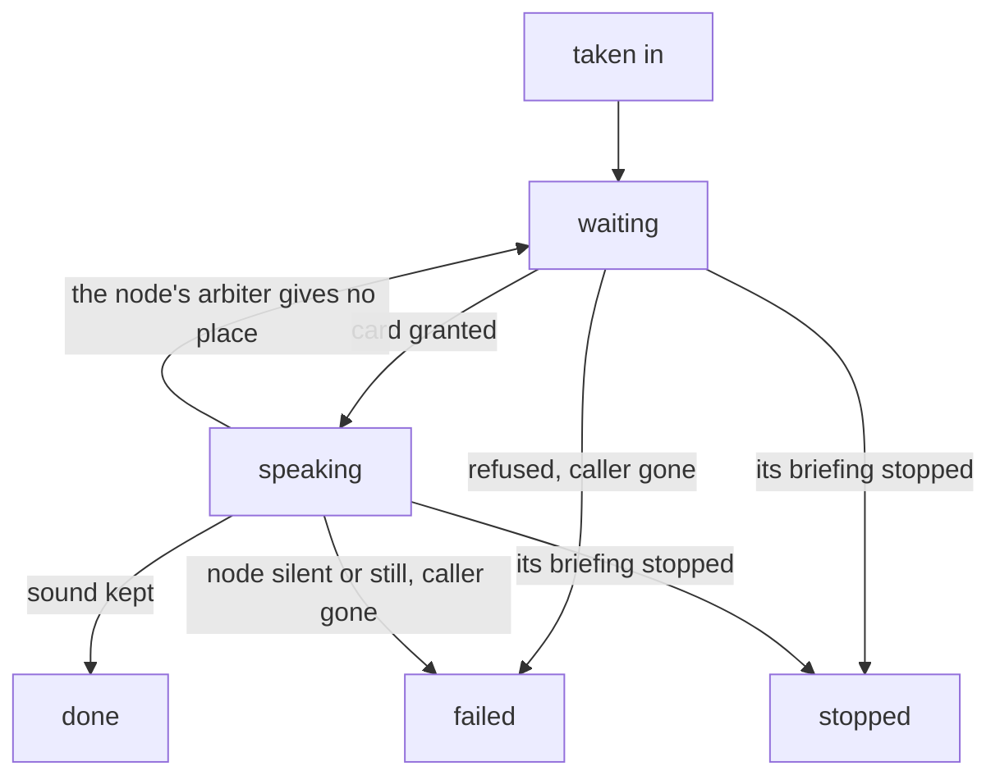

# The voice engine's boundary

Fixed at 0.1.0-rev.32.

Every route this engine answers, its event stream, the calls it makes, its harness plugin, its hosted tool,
its command line and its settings. The engine is an upstream: a coding harness takes it as its first entry
point through its MCP server, with no console and no other unit running. The engine keeps briefings, each a
line spoken for a room and kept with that room, its line and its moment, and tells its listeners when one is
spoken; when a briefing is spoken, and what it says, is its caller's decision, and speaking to listeners on a
schedule is a caller's work too.

`docs/openapi.json` is the contract: an OpenAPI 3.1 document written from the service's own types, stating
every route with its parameters, its body, its answers and the codes it can answer, the bodies' schemas, the
events under `x-events`, the harness plugin under `x-harness` and its tools under `x-tools`. `bmo-voice
openapi` prints it as the repository keeps it. A change to anything here changes this document and that one
in the same commit, and moves the version (「Versions」).

## Conventions

The common wire format and the API design rules are bmo-chat's `docs/conventions.md`; this engine keeps them.

- **Every route, `GET /health` among them, needs `Authorization: Bearer <token>`,** the token of the
  settings' token file; a missing or wrong token is answered 401 `unauthorized`. A token file that holds
  nothing lets no caller in.
- **Bodies are JSON, both ways, with field names in camelCase.**
- **Times are integers of epoch milliseconds,** each field ending in `At`; spans end in `Ms` and counts in
  `Count`.
- **A failure** is a non-2xx answer whose body is `code`, a kebab-case code a caller matches on, and
  `error`, an English sentence for a log (「Codes」). A method and path no route answers is 404 `no-route`.
- **A list is a page,** `{"items": [...], "more": boolean}`. `more` says whether anything stands past the
  last item. A list takes `after`, the cursor its route states, and `limit`, 1 to 1,000 and 100 where
  absent.
- **A byte answer** is a member's `sound`, carries OGG/Opus, and honours `Range`.
- **Nothing in the API names an agent, an owner or a worker.** Who a caller speaks for is its own business. A
  briefing carries the room and the line its caller names, as the numbers the caller gives, which the engine
  keeps and matches on and never reads into.

## Health

`GET /health` answers `ready`, `reason` (null while ready) and `version`. A service that answers has its
store open and migrated.

## Events

`GET /events` is the service's one stream, server-sent events, or a page of the same events to a reader
asking `Accept: application/json`.

| Event | Data |
|---|---|
| `synthesis.created` | the synthesis as `GET /syntheses/{synthesisId}` answers it, state `waiting` |
| `synthesis.ended` | the synthesis, state `done`, `failed` or `stopped` |
| `transcription.ended` | the transcription, state `done` or `failed` |
| `voice.changed` | a voice as `GET /voices/{voiceName}` answers it |
| `briefing.created` | the briefing as `GET /briefings/{briefingId}` answers it, state `waiting` |
| `briefing.ended` | the briefing, state `done`, `failed` or `stopped` |
| `briefing.changed` | the briefing, after its line was named or let go |
| `briefings.stopped` | `chatId`, the room whose briefings were stopped or null for every room, `kind`, the kind stopped or null for every kind, and `briefingIds`, those it stopped |

- **A frame's `event` is the kind,** its `id` the event number, a signed 64-bit integer that only grows,
  and its `data` is `{"id", "kind", "at", "data"}`, the inner `data` being the member.
- **Events run in the order of the changes they tell.** A change that is told is written and its event kept
  under one hold of the event log, so each event's member is as that change left it, and a change made after
  another is numbered after it: a briefing's `briefing.changed` comes after the `briefing.ended` of an end
  written before its line was named, and a stop's events after any end its lines kept first. A route that makes
  a change answers once its event is kept; a read of the member may show a change its event is a moment behind.
- **A reader resumes** with `Last-Event-ID` or `?after=`, and narrows with `kinds`, a comma-separated list.
  A stream asked with neither reads on from the newest event kept, the live ones only, and a page asked with
  neither starts at the oldest kept. The last
  1,000 events are kept; a resume from before them is answered 410 `gone`, and the reader reads the
  collections again.
- **A page** is read with `after` and `limit`.
- **A comment line every fifteen seconds** keeps a stream open. Every stream ends as the service is asked to stop,
  so a stop waits on no reader.

## Voices

| Route | Query | Answer |
|---|---|---|
| `GET /voices` | `after`, `limit` | a page of voices, in name order |
| `GET /voices/{voiceName}` | | one voice |

- **A voice:** `name` (its key), `language` (the language data's code for the language it speaks),
  `checkpoint` (where its weights stand), `engine` (the engine its folder's `voice.toml` names, `voxcpm2` for a
  folder that names none), `served` (true where that engine is the one the voice speaks, the policy's `engine`),
  `emotions` (the emotions it may be asked to speak with) and `changedAt` (epoch milliseconds of its last change).
- **The cursor is the last voice's `name`.** A name no voice holds is answered 404 `not-found`.
- **The emotions are the engine's policy values** (`policy/voice.toml`, 「The policy」), the same for every
  voice.

## Syntheses

| Route | Body or query | Answer |
|---|---|---|
| `POST /syntheses` | `voiceName`, `text`, `spoken?`, `language?`, `emotion?`, `style?`, `seed?`, `key?` | 201, the synthesis; 200, the one its `key` already names |
| `GET /syntheses/{synthesisId}` | | one synthesis |
| `GET /syntheses/{synthesisId}/sound` | | the sound, OGG/Opus, with `Range` |

- **A synthesis:** `id`, `voiceName`, `text` (the written words), `spoken` (the words the voice says, null until
  they stand; 「The spoken words」), `emotion`, `key` (the caller's key, null where none was given), `state`,
  `wait`, `waitingOn`, `failure`, `durationMs` (null until done) and `createdAt`.
- **A synthesis is answered at once;** the speaking runs apart on the voice server of the card the arbiter's
  master grants it (「The voice servers and the card」), and the caller reads the member again until its
  state is `done` or `failed`. `done` carries `durationMs`, the sound's length read from its Ogg pages.

### Its states

- **`waiting`:** taken in, its spoken words being derived or its card not yet granted.
- **`speaking`:** its card is granted and the line is on that card's node.
- **`done`:** its sound stands. **`failed`:** it ended without one, and `failure` says why.
  **`stopped`:** its briefing was stopped before it ended (「Briefings」); it has no sound and is never spoken again.
- **`done`, `failed` and `stopped` are ends:** a synthesis that reached one never moves again.

### What it waits on

- **`wait` says what a synthesis that has not ended waits on,** and is null on one that ended:
  - `on`: `words` while its spoken words are derived, `demand` while its card is not granted, `node` once the
    line is on the node of the card granted;
  - `node`: the node of the card granted, null before;
  - `demandId`: the master's demand the line holds its card by, null before the grant;
  - `since`: when the synthesis began to wait on what it waits on now.
- **`waitingOn` is an English sentence saying the same,** for a person or a log:
  - while its words are derived, how the derivation stands (「How the engine derives the spoken words」);
  - while its card is not granted, that the card is being asked of the master until it first answers, then the
    master's reason (every card in use, a card held by a claim or a lower tier, the service starting), its place in
    the line, or the master not reached;
  - once the line is on its node, that node and where the line stands there: asked of the node, behind another
    line on its voice server, waiting for its turn on the card, waiting for room on the card for the model,
    loading the voice, the piece it speaks of how many, its sound carried back.
- **Both are this process's:** a synthesis taken up by a new process names its wait again as that process waits.
- **`state` and `wait` are answered as one:** a synthesis that has not ended is `speaking` while its `wait` is on
  `node` and `waiting` while it is on anything else, in the same answer, whatever moment the read falls on.
- **`failure` is an English sentence saying why a `failed` synthesis ended,** naming the node, the stage and the
  clock where one of them ended it, or `its reason was not kept` where the engine never held one; null on every
  other.

### The clocks

Three clocks end a synthesis that nothing else would end. Their spans are the policy's (「The policy」).

| Clock | Span | What it bounds | `failure` |
|---|---|---|---|
| the caller's | `caller_gone_seconds`, 120 | a synthesis taken in through `POST /syntheses` that its caller has not read for the span | its caller has gone, not having read it for the span |
| the node's answer | `node_answer_seconds`, 60 | each call the line makes to reach its node: the node service's target for it, and each command on the node's shell | the node, and that it did not answer within the span |
| the node's progress | `node_still_seconds`, 600 | a line on its node that stands still: its stage on the voice server unchanged and no line of that server moving | the node, the stage the line stood at, and the span |

- **A caller reads its synthesis** by `GET /syntheses/{synthesisId}`, by its sound, or by a `POST` naming its key;
  each read starts the caller's clock again. A synthesis taken in starts it, and so does one taken up as the
  service starts. A briefing's synthesis has no caller's clock: its caller is the room, and its end is the
  stop's (「Briefings」).
- **Nothing else bounds a synthesis.** A wait for the card ends only by its grant, a refusal of the master's, its
  caller's clock or its briefing's stop; a line on its node that keeps moving is spoken however long it is.
- **A synthesis a clock ends** gives back its card, ends the call on its node, and is told as `synthesis.ended`,
  state `failed`, its `failure` saying which clock and why.

### What the journal says

- **The service writes a line to its journal for each synthesis** as it is taken in or taken up, each time what
  it waits on changes in kind (its words, its card's reason, the node granted and the line's stage there), and
  as it ends `done`, `failed` or `stopped`. Each line opens with `voice: synthesis <id>` and names the node and the
  demand where they stand; a piece of a long line does not take a line of its own.
- **The line of its end says where it stood:** one a clock or its stop ends names the node and the demand its
  line was on, or what it waited for where it had no node yet (its spoken words, its card); one its node failed
  names that node in its reason.
- **No line of the journal carries the words** of a synthesis.

### Taking a synthesis in

- **`text` must hold something to say,** in at most 10,000 characters, and a `spoken` given holds at most 30,000;
  either longer is answered 400 `bad-request`. A `spoken` given that holds nothing, or that fails the check, is
  answered 422 `unconverted-run` (「The spoken words」). A voice no list holds is answered 404 `not-found`; a voice
  that is not served is answered 422 `retired-voice`; an `emotion` outside the voice's is answered 422
  `unknown-emotion`. `style` and `seed` are laid over the voice's row for this one synthesis.
- **A line taken in is spoken whatever its length.** Its voice server is handed the spoken words whole and speaks
  them piece by piece into one sound (`docs/voice-plan.md`, 「What a long line takes of the card」); no line within
  the bounds above is refused or cut off for its length: the node's clocks bound a node that does not answer or a
  line that stands still on it, never a line that keeps moving (「The clocks」).
- **The sound** is answered only once the state is `done`; before that, and where a failed synthesis left
  none, 404 `not-found`. A sound is kept under the data root, never in the database.
- **A line a stopped process left is taken up by the next.** As the service starts, every synthesis still
  `waiting` or `speaking` is spoken again from its words, in the language it was taken in with, its spoken
  words derived where none stand, and a briefing spoken by it is ended and told as its synthesis ends. One whose
  voice no list holds any more, or whose voice is not served, fails. Nothing a caller took in is left `waiting`
  with no process to speak it.
- **A key makes a line once.** `key` is the caller's own name for a line, of at most 200 characters and not blank,
  in whatever shape the caller keys its work by. A `POST` naming a key that a synthesis `waiting`, `speaking`,
  `done` or `stopped` already holds takes nothing in and is answered 200 with that synthesis, whatever else the body says; once
  the one holding it has `failed`, the key takes a new one in. Two calls with one key at once take in one synthesis
  between them. A key that is blank or longer is answered 400 `bad-request`.
- **One synthesis speaks one text.** There is no list route: a caller that wants to know a synthesis it
  started reads its member or listens to the stream.

## The spoken words

Every line the engine speaks, a synthesis's and a briefing's alike, is two texts, and no line reaches a voice
server any other way.

- **`text` is the written words:** what people read of the line, the caption, the reading a road folds under a
  voice note, a transcript. The engine keeps them as they were given, and a briefing's as the script its reading
  rules make of them (「Script readings」); nothing else changes them.
- **`language` is the language the line is said in,** `ko` or `en`, the voice's own where absent; any other is
  answered 400 `bad-request`. A voice says a line of either language, and the spoken words are made and checked
  in the line's.
- **`spoken` is the words the voice says:** the same words as a reader of the line's language says them aloud.
  Every foreign name, acronym, product name and model name stands in that language's reading, every number,
  date, time and unit in the words a reader says, and a web address, a file path, code and markup are said in a
  few words for what they are or left out. What is said in one breath stands as one word with no space inside it,
  a decimal, a version and an acronym read by its letters among them, since a voice pauses at every space, and
  inside it the syllables are written as they sound in that breath, a final consonant carried onto the vowel after
  it, since a voice says what is spelled. A number of four digits or more is two runs, broken after its
  hundreds, with its counter written onto the last. An
  identifier that is no word, a commit hash among them, is said by its first four characters alone. A time zone's
  abbreviation is said as the place it names, before its time. Nothing else differs from the written words.
- **A language model makes them, with judgement; no table and no rule of the engine's does.** Context decides how
  a name, an acronym or a number is read aloud, so no reading table, substitution or romanisation produces them,
  and the engine's own reading rules (「Script readings」, `docs/voice-plan.md`) unfold markup into the written
  words and never read them. A caller writes them itself and passes `spoken`, or passes `text` alone and the
  engine derives them (「How the engine derives the spoken words」).
- **The check:** before a line is spoken its spoken words are checked for what was left unconverted. It finds,
  and the engine never mends:
  - a letter of another script than the line's language writes: a Latin letter in a Korean line, a Hangul letter
    in an English one;
  - a digit, in every voice;
  - the marks a web address, a path, code or markup is written with: a slash or a backslash, and any of
    `` ` `` `*` `_` `#` `|` `<` `>` `[` `]` `{` `}` `~` `=` `^` `@` `$` `%` `&` `+`, and a character of the
    private use area.
- **A `spoken` a caller passed that fails the check is refused** 422 `unconverted-run`, the sentence naming the
  first word that failed and what it holds, so a caller that claims to have converted a line and did not is
  caught; it corrects that word and asks again. A derived one that fails is asked of the model again.

## How the engine derives the spoken words

- **On a slot of agency's co-worker pool,** asked for the role `[spoken]` names in the settings,
  `transliterator` where they name none, on the road its role's order picks, or on the provider and model they
  name where they name the two together. The role is a registration of agency's (its `docs/agent-roles.md`) and
  must stand there; the engine creates none.
- **In one role's session for the whole derivation,** started on the slot once it is let in, so the session
  runs as the slot's role on the provider, model and effort the slot was let in on; on the runner line
  `[spoken]` names, `search` where it names none, its instructions the engine's own (`prompts/spoken-words.md`)
  and no tool allowed. Each try is one turn in it, handing the model the line's language, the agreed readings,
  the written words, in a Korean line the language's examples of runs written as they sound
  (`data/ko/voice-script.yaml`), and, where the answer before failed the check, the word it failed on; a turn names no
  road of its own. The session is ended and the slot given back once the spoken words stand; a slot or a
  session agency no longer holds is given up and a new one asked, and no try leaves a session of its own
  standing.
- **A turn that ended with no answer is no answer to read.** Agency answers a turn's end with its `outcome`
  and, where it has one, its `reason`; a turn that wrote nothing and whose outcome is not `answered` — one
  that failed, or was stopped — is a try that did not answer, said with that outcome and reason, and its
  session and slot are given up, so the next try stands on a new session.
- **Agency binds the slot to the session** as it starts it, so the slot stands for as long as the session does
  and is given back with its end (agency's `docs/role-slots.md`, 「The line」); the engine binds nothing itself,
  and its own give-back after the session's end finishes a slot agency may already have given back.
- **The agreed readings come first, the model's judgement after:** every row of the voice name table
  (`docs/store.md`, `voice_names`) with a reading in the line's language is handed over as a reading to apply
  as it stands, and the model reads whatever else the words need with its own judgement.
- **A reading the model chose is kept:** its answer names each name it read that the readings did not hold, and
  each is written into the voice name table, so the same spelling is read the same way next time. A spelling
  the table holds is never written over: the owner's correction of a row (`scripts/voice-names.ts --set`) wins
  from then on. A chosen reading that holds what the check finds is not kept, and neither is one for an
  identifier, a run of seven or more hexadecimal characters holding a digit: it names one commit or one digest and
  is never read again.
- **A slot waits in its role's line while the engine asks for its admission,** again every two seconds until it
  is let in, with no bound on how long: the line lets in only a request whose owner is asking now. Each
  admission answers the request's `state`: `waiting` or `reserved` is asked again, `active` is let in, and
  `released` or `cancelled` is a request given back, whose `endedBy` and `outcome` say who gave it back and
  why, and which is never asked about again.
- **A slot's owner is its synthesis,** `voice:synthesis:<synthesisId>`, and its request key that owner and a
  number drawn at random for the ask, so no key a given-back request spent is asked again, by this process or
  the next. A slot waiting while agency is not reached is asked about again, never left for a new one; one
  agency no longer holds, or given back before it was let in, is dropped and a new one asked under a key of
  its own.
- **Agency is the truth at start.** Before the lines an earlier process left unspoken are taken up, everything
  the owner of each such synthesis holds is given back (`DELETE /slot-requests?owner=`): every slot it asked,
  waiting or let in, and every session agency bound one of them to. A slot a process that is gone left holds
  no place of the role's cap, and the engine keeps no list of the slots it holds.
- **Derived spoken words hold at most 30,000 characters,** the bound a caller's `spoken` is held to; a longer
  answer does not stand and is asked again, as one that fails the check is.
- **Nothing gives it up.** An answer that fails the check, one that does not read, a turn that ended with no
  answer, a slot or a session agency refuses and agency not reached are each asked again five seconds later,
  however often; `waitingOn` says which
  it was and why, and the synthesis stays `waiting` until its spoken words stand. They are kept as its
  `spoken`, and its card is asked after.

## Briefings

| Route | Body or query | Answer |
|---|---|---|
| `POST /briefings` | `voiceName`, `text`, `spoken?`, `language?`, `chatId`, `messageId?`, `kind`, `title?`, `emotion?`, `plays?`, `key?` | 201, the briefing; 200, the one its `key` already names |
| `GET /briefings` | `chatId?`, `messageId?`, `kind?`, `awaitsLine?`, `after`, `limit` | a page of briefings, newest first |
| `GET /briefings/{briefingId}` | | one briefing |
| `POST /briefings/{briefingId}/line` | `messageId`, a number or null | the briefing |
| `GET /briefings/{briefingId}/sound` | | the sound, OGG/Opus, with `Range` |
| `POST /briefings/stop` | `chatId?`, `kind?` | the briefings it stopped, a page whose `more` is false |

- **A briefing is a line spoken for a room in a voice,** kept with the room and the line it speaks: `id`,
  `chatId`, `messageId` (the line, null while it awaits one), `kind`, `title` (null where none was given),
  `voiceName`, `text` (what was spoken), `emotion`, `synthesisId`, `state`, `durationMs` (null until done),
  `plays`, `awaitsLine`, `voiceMessageId`, `startedAt` and `finishedAt` (null until it ends).
- **Two kinds.** A `summary` is what a listener hears live: a line or two of a line's gist, written to be heard,
  with a one-line title a listener shows in place of the words. A `full` reading is a whole line read out, kept on
  that line, which a listener plays only when asked; it names its line, and one that names none is answered 400
  `bad-request`.
- **It is spoken as a synthesis is.** `POST /briefings` answers at once, state `waiting`; the engine reads the
  words into a script by its own reading rules (「Script readings」), and the script is the written words of a
  synthesis in the named voice, `spoken` its spoken words where the caller gave them and derived where it did
  not (「The spoken words」), spoken on the voice server of the card granted it. `text` is the script. Its `state` and
  `durationMs` are its synthesis's, and `synthesisId` names it, whose `wait` and `waitingOn` say what it waits
  on and whose `failure` says why a failed one ended. `text` must hold something to say, within a synthesis's bounds (「Syntheses」); a `spoken` that is empty or
  fails the check is 422 `unconverted-run`, a voice no list holds is 404 `not-found`, a voice that is not served is
  422 `retired-voice`, and an emotion outside the policy's is 422 `unknown-emotion`.
- **A key makes a briefing once,** as it does a synthesis (「Syntheses」): the key is its synthesis's, and a `POST`
  naming a key the synthesis of a briefing holds, not yet `failed`, is answered 200 with that briefing. A key a
  synthesis holds that speaks no briefing is answered 409 `conflict`.
- **Whether it plays by itself is the caller's to say** in `plays`, true where absent, and the engine keeps what
  it was told. A listener plays by itself only a `summary` whose `plays` holds, once `briefing.ended` says it is
  `done`; it plays a `full` reading only when somebody asks for it, and shows a briefing it learns of more than
  two minutes after it ended rather than playing it.
- **Stopping silences at once.** `POST /briefings/stop` stops every briefing of the room `chatId` names, or of
  every room where the body names none, of the kind `kind` names, or of every kind where it names none, that has
  not ended: one `waiting` and one `speaking` alike, and one whose synthesis is done but whose end is not yet told.
  A `kind` other than `summary` and `full` is answered 400 `bad-request`. Each is `stopped` from that moment, its `finishedAt` the
  moment it was stopped; its speaking is ended where it runs, its card given back, and no sound of it is served. Each is told as `briefing.ended`, its synthesis as `synthesis.ended`, and then one `briefings.stopped`
  names the room, the kind and the briefings it stopped, told even where it stopped none. A stopped briefing never plays and
  is never spoken again, whatever its caller does next: its key stays held, so a `POST` naming the key answers it,
  `stopped`, and a restart takes up no stopped line. A briefing that ended before the stop keeps its end.
- **A listener hearing `briefings.stopped` falls silent for its room and its kind,** for every room where `chatId`
  is null and for every kind where `kind` is null: it stops the briefing of that room and kind it plays, and plays
  by itself none of that room's briefings of that kind that ended before the event. A stop of summaries leaves a
  full reading somebody asked for playing.
- **A summary may be spoken before its line stands.** One taken in with no `messageId` awaits its line, and
  `POST /briefings/{briefingId}/line` names it, or lets it go with null; either way it no longer awaits one, and
  `briefing.changed` says so. A full reading's line is never moved; asking is 409 `conflict`.
- **The page** is read newest first; the cursor is the last briefing's `id`, as a number, and the page starts
  below it. `chatId`, `messageId`, `kind` and `awaitsLine` narrow it.
- **A briefing the engine did not speak,** a row kept from before it spoke briefings, names no synthesis and no
  voice, reads `done`, and serves no sound; `voiceMessageId` names the voice message the room heard it as.
- **The sound** is answered only once the state is `done` and the engine spoke it; before that, 404
  `not-found`. It is the synthesis's own sound, kept under the data root.

## Transcriptions

| Route | Body | Answer |
|---|---|---|
| `POST /transcriptions` | `language`, `files` | 201, the transcription |
| `GET /transcriptions/{transcriptionId}` | | one transcription |

- **A transcription:** `id`, `language`, `state`, `text` (null until done) and `createdAt`. Its state is
  `waiting`, `running`, `done` or `failed`.
- **`files` are paths on the engine's own machine,** one or more, in the order their words are answered. A
  language other than `ko` or `en` is answered 400 `bad-request`.
- **The answer is immediate,** state `waiting`; the transcription runs apart and ends `done`, with `text`
  holding one file's words to a line in the order given, or `failed`. The end is published as
  `transcription.ended`.

## Encodings

`POST /encodings` with `fromWav`, the path of a reference recording on the engine's machine, writes it out
as an OGG/Opus sound and answers 201 with an encoding: `id`, `state` (`done`) and `createdAt`. A path that
is no readable file is answered 422 `unreadable-source`; a failed encode is 500 `failed`. The sound is kept
under the data root; no route serves it.

## Script readings

`POST /script-readings` with `text` and `language?` answers 200 with `script`, the text made speakable by the
engine's own reading rules, and `sentences`, the script cut after each of its end marks, their marks kept.
It asks no model, takes no card turn and keeps nothing. A language other than `ko` or `en` is answered 400
`bad-request`.

## Voice servers

`GET /voice-servers` answers a page of the voice servers on the voice nodes, in the node list's order.

- **A voice server:** `nodeName` (its key), `state` and `voiceNames`. `state` is `running` where the node's
  server answers, `absent` where the node cannot be reached or its server does not answer.
- **`voiceNames`** are the voices whose checkpoint the server holds loaded, in name order; empty where it
  holds none or does not answer.
- **The cursor is the last server's `nodeName`.**

## Codes

| Code | Status | Meaning |
|---|---|---|
| `bad-request` | 400 | the body or the query is not the shape the route takes; the sentence names what is wrong |
| `unauthorized` | 401 | the token is missing or wrong |
| `no-route` | 404 | no route answers the method and path |
| `not-found` | 404 | nothing stands at the key the path names |
| `conflict` | 409 | the change asked for does not fit the member as it stands |
| `gone` | 410 | the events since the number asked for are no longer kept |
| `unknown-emotion` | 422 | the emotion is not one of the engine's policy values |
| `retired-voice` | 422 | the voice belongs to an engine the voice no longer speaks; it is kept and never spoken |
| `unreadable-source` | 422 | an encoding's wav is not a file the engine can read |
| `unconverted-run` | 422 | the spoken words given hold nothing, or hold what the check finds; the sentence names the first word that failed |
| `failed` | 500 | the engine failed; the sentence is the failure |

## The voice servers and the card

- **Each voice node runs `synth/voice-fish.py` on the engine environment** as the user unit
  `bmo-voice-server.service`, listening on the node's loopback and taking a line on the node's own shell
  (`docs/voice-plan.md`, 「The voice nodes」).
- **A voice server takes its turn on the node's card through the card arbiter's own turn client,** installed
  on the node by the arbiter, and holds the card lock while it speaks.
- **The card declaration** is `weights/voice.card.toml`: the service `voice`, standing on every node its placement
  names (`spread` `many`), not alone and at a priority below every service that stands alone on the GPU nodes, so it
  joins the reservation of the node it is placed on (`docs/voice-plan.md`, 「Where they run」), yielding the card by
  its turn, its adapter the node scripts' own. The master reads it from
  this repository's deploy tree (`docs/deploy.md`); no node is named in it.
- **Which node speaks a line is the arbiter's master's to say.** Every synthesis asks the master a demand for
  one card of the service `voice`, naming no node, with the work key `voice:synthesis:<synthesisId>` and a
  reference naming the synthesis and its voice. The line is spoken on the node of the card granted, reached as
  the node service's answer for that node says, and the demand is given back once the line ends, spoken or
  failed.
- **One read of the master serves every waiting line.** No waiting line holds a request of its own open: while any
  line waits, the engine reads every demand the master holds once a second, and each waiting line takes its
  demand's state from that read. However many lines wait, the master is read through one request at a time.
- **A line holds one demand at a time, and forgets it only on the master's word.** A read of every demand may
  have been taken before a line's demand was asked, so a demand the read does not hold is read again by its id,
  and only the master's `404` for that id is the demand no longer held; absence from a read is never enough. An
  ask whose answer did not arrive may have been taken in, so before it is asked again the master's demands are
  read for one of the line's work key: the first found is the line's demand, and any beyond it are given back.
- **Every line runs on the service's one runtime and through its one HTTP client,** whose idle connections are
  kept to a bound, so a waiting line holds no thread, poller or socket of its own.
- **The wait for the card ends only by its grant,** a refusal of the master's, the caller's clock or a briefing's
  stop (「Syntheses」, 「The clocks」). While the master holds the demand in line, or cannot be reached, the
  synthesis stays `waiting`, its `wait` on `demand` and its `waitingOn` saying why. A master that answers `404` for the demand, one
  restarted, is asked a new one. `voice` placed on no node (`no-place`) and any other refusal of the master's
  fail the synthesis at once, the demand it held given back.
- **A card the node's arbiter keeps from the line:** where the node's server answers that its card arbiter gives the
  voice no place on the card (503), the demand is read again until its card is granted again, and the line is asked of
  that card's node once more, the synthesis `waiting` on its demand meanwhile.
- **Every demand the engine holds stands in its ledger** (`docs/store.md`, 「The folder」) from its asking until
  the master answers its give-back, `204` or `404`, or answers `404` for it by its id; a give-back the master
  refuses leaves it there.
- **The master is the truth at start.** Before any line of the new process asks, every demand the ledger holds
  is given back, and so is every demand the master holds whose work key is `voice:synthesis:<synthesisId>`, since
  no line of the new process holds one yet: what a process left behind, in the ledger or not.
- **A node out of reach is never quietly replaced by this machine's card:** the synthesis fails, naming the node
  and what it met.
- **A line on its node is followed by its stage.** The voice server writes where each line it holds stands, beside
  the call's files on the node, each time that changes: behind another line, waiting for its turn on the card,
  waiting for room on the card, loading the voice, each piece spoken. Every look the engine takes at the call reads
  the line's stage and the moment any line of that server last moved; the line's `waitingOn` names the stage, and
  the node's progress clock ends a line whose stage and server both stand still for its span (「The clocks」).
- **A line the engine lets go of is ended on its node:** where a clock or a stop ends it, or it ends any other way,
  the asker started for it on the node is ended with its process group and the call's files are removed, and the
  voice server drops a line whose asker has gone rather than take the card for it.

## What the engine calls

### bmo-node

| Call | Route | Used for |
|---|---|---|
| a node's target | `GET /nodes/{name}/target` | how a voice node is reached: `kind`, then an ssh node's `host`, `port`, `user`, `keyPath?`, `shell?` and `sshArgs`, the arguments that open a batch SSH login ahead of the command, or a hub node's `hubAddress`, `hubTokenFile` and `agentName` |

A refusal of the node service is read as its own answer, `answered` false and a `refusal` carrying `code` and
`message`, and carried as the engine's failure.

### bmo-arbiter

The arbiter's master (its `docs/api.md`, 「Demands」).

| Call | Route | Used for |
|---|---|---|
| a demand | `POST /demands` with `serviceName` `voice`, `count` 1, `workKey` and `ref` | a card of `voice` for one synthesis: `201` granted, `202` waiting, `422` `no-place` where `voice` is placed on no node |
| the demands read | `GET /demands` | every demand the master holds: read once a second while any line waits, each waiting line's demand as it stands; read for a line's work key where its ask was not answered; and read once as the service starts, for the demands of `voice:synthesis:` work keys an earlier process left |
| a demand read | `GET /demands/{demandId}` | a line's demand as it stands where a read of every demand did not hold it, or once other work held its card from under the line; `404` alone is the master holding it no more |
| the demand given back | `DELETE /demands/{demandId}` | `204`, or `404` where it is given back already |

- **A granted card** is the first of `cards` on a demand `granted` with nothing `taken`; its `nodeName` is the
  node that speaks the line.
- **The master not reached,** an answer of 502 or 503 and an answer that does not arrive are all asked again a
  second later, however often.

### bmo-agency

The co-worker pool and its role's sessions (its `docs/api.md`, 「slots, reservations and places」 and
「sessions」), for the spoken words a synthesis is derived (「How the engine derives the spoken words」).

| Call | Route | Used for |
|---|---|---|
| a slot | `POST /slot-requests` with `owner` `voice:synthesis:<synthesisId>`, `requestKey` `voice:synthesis:<synthesisId>:<drawn>`, a number drawn at random for the ask, `role`, `source` `voice`, and `provider` and `model` where the settings name them | the slot the derivation runs on, with its token, its state and the provider, model and effort it is let in on |
| its admission and its end | `PATCH /slot-requests/{token}` | asked with no state, again and again while its `state` is `waiting` or `reserved`, until it is `active`; `released` or `cancelled`, with `endedBy` and `outcome`, ends the asking and a new slot is asked; given back with `finished` and its outcome, `cancel` where no turn ran; never bound by the engine |
| everything a synthesis holds | `DELETE /slot-requests?owner=voice:synthesis:<synthesisId>` | asked as the service starts, for each synthesis an earlier process left unspoken, before it is taken up: its slots given back and the sessions bound to them ended |
| a session | `POST /sessions` with `scope` `role`, `slot` the slot's token, `line`, `systemPrompt`, `labels` naming the synthesis and `toolsAllowed` empty | the derivation's role's session, on the slot's role, provider, model and effort, agency binding the slot to it; `422` `slot-not-active` or `contradicts-slot` and `503` `line-not-carried` give the slot back and a new one is asked |
| its turns | `POST /sessions/{sessionId}/turns` with `prompt`, `resume` `fresh`, `name`, `title`, `chat` 0 (the derivation stands under no room), `hearsWords` false and `variables` empty | one try on the session's road, answered once it ends; its `answer` is the model's, else its `text` blocks joined, and where it wrote neither its `outcome` and `reason` say how it ended |
| its end | `DELETE /sessions/{sessionId}` | the session ended once the spoken words stand; one still busy is asked again |

### bmo-web

| Call | Route | Used for |
|---|---|---|
| sign-in | `POST /sumida/auth/session` with `username` and `password`, then `DELETE /sumida/auth/session` with the `bmo.sid` cookie it answered | the script studio's sign-in: a name and a password the account service takes are a login, a 401 is a wrong one; the studio keeps its own session after |

### bmo-artifact

The archive (its `docs/api.md`, 「Attachments」), called by the command alone, never by the service.

| Call | Route | Used for |
|---|---|---|
| an attachment | `POST /documents/{documentId}/attachments` with `name`, `mediaType`, `role` and `content` in base64 | a document's narration, kept as its head sound (「Narrating a document」) |

## The harness plugin

- **The MCP server is `bmo-voice mcp`,** on standard input and output. It calls the engine at the settings'
  address with the settings' token; `--address` and `--token` name them instead.
- **Its tools,** each a thin call of one route through the engine's own client:

| Tool | Route |
|---|---|
| `voice_voices` | `GET /voices` |
| `voice_synthesize` | `POST /syntheses` |
| `voice_synthesis` | `GET /syntheses/{synthesisId}` |
| `voice_transcribe` | `POST /transcriptions` |
| `voice_script` | `POST /script-readings` |

- **The `bmo-voice` skill** tells a harness when and how to use them. A tool's failure carries the status,
  code and sentence of the refusal, or the sentence saying why nothing answered.

## The hosted tool

- **The tool host serves two entries from the voice's own folder** (bmo-pocket's `docs/mcp-host.md`, 「Placed
  tools」): a session the shell guard keeps off every unit's loopback port, the chat agent among them, reads
  through `voice/servers` which voice nodes stand in the voice node list and whether their servers answer, since
  the tool host runs it outside every harness; and a worker whose role holds `room.send`, the producer among them,
  writes a finished synthesis's sound through `worker/voice_sound`. It is the folder `tools/servers/`, the crate
  `voice-servers-tool`, built into the release and placed before the flip for this service, with the capabilities
  its entries ask for allowed (`docs/deploy.md`).
- **`voice/servers`** asks for `room.tools`, is read-only and takes no arguments. **`worker/voice_sound`** asks for
  `room.send`, takes a `synthesisId`, the `key` the synthesis was taken in under and the absolute `path` to write,
  and answers the path with the bytes written. The tool host keeps no clock on either call, which ends when the
  engine has answered. The executable speaks the tool host's call protocol 1 itself: one request on standard
  input, one tool result of text on standard output.
- **What `voice/servers` answers:** every page of `GET /voice-servers`, called through the engine's own client, as
  one line a voice server in the node list's order, with its node's name, its `state` and the voices it holds
  loaded; then a line saying where a line is spoken now (`docs/voice-plan.md`, 「Which road speaks a line」): on the
  voice server of the listed node the arbiter's master grants a card of `voice`, where any is listed, and, where
  none is, nowhere, since a synthesis fails and nothing speaks on the operations machine's card.
- **What `worker/voice_sound` answers:** the synthesis at `GET /syntheses/{synthesisId}`, then, where it is done
  and carries the given key, the bytes of `GET /syntheses/{synthesisId}/sound` written at `path` whole or not at
  all, the folders it names made where they do not stand and a file already there replaced. Only the caller's own
  line is written: a synthesis taken in with no key, or under another key, is refused, since the key is the
  caller's own name for the line. The sound is OGG/Opus, as the route answers it.
- **Its settings** are the file `BMO_VOICE_SETTINGS` names, else `settings.toml` under the link of the voice's
  deploy tree, `~/.local/share/bmo-voice/deploy`: the tool host runs the registry's copy of the placed folder,
  which stands in no release. Both entries call the settings' address with the settings' token.
- **What it refuses,** each as an answer marked as an error: settings or a token that do not read, with the
  sentence saying why; an engine that does not answer, or one that refuses, carrying the status, code and sentence
  of the refusal, or the sentence saying why nothing answered, as the harness plugin's failures do; the sound's
  arguments when they do not read, naming what is wrong; a synthesis that is not the caller's own or is not done,
  naming the key or the state; a path that is not absolute or could not be written, naming it; and a call of
  another entry, naming its own. It serves no resources, and a kind of request it does not answer ends the call
  unclean.

## The command line

`bmo-voice` serves the harness plugin, the document and the ear and mouth groups' first-class verbs: it
declares the nouns `listen`, `brief` and `brief-attach` when asked `nouns`, so the platform hands `bmo listen`,
`bmo brief` and `bmo brief-attach` straight to it.

| Word | What it does |
|---|---|
| `nouns` | answers `listen`, `brief` and `brief-attach`, one a line |
| `listen <file>…` | asks `POST /transcriptions` for the files in `--language` and waits for it to end, however long it takes; prints what was heard, or the transcription as JSON with `--json` |
| `brief` | asks `POST /briefings` for a line spoken in `--voice` for the room `--chat`, of kind `--kind` (`summary` or `full`), with `--text`, and optional `--spoken`, `--title`, `--emotion`, `--message` and `--plays`; waits for the engine to speak it, however long it takes, then prints its id, or the briefing as JSON with `--json` |
| `brief-attach <document> <file> [voice]` | speaks the text the file holds as a document's narration and attaches its sound to that document of the archive, waiting at most `--within` minutes for the synthesis (「Narrating a document」) |
| `health` | asks the service the settings name for `GET /health`, with its token, and exits 0 where it answers ready, 1 where it answers otherwise or nothing listens; it waits for the answer however long it takes |
| `mcp` | runs the harness plugin's MCP server; `--address` and `--token` name the engine |
| `openapi` | prints `docs/openapi.json` as the repository keeps it |

### Narrating a document

- **What it asks:** `POST /syntheses` for the file's text, in the voice named, else the settings' narration voice
  (「Settings」); with neither it is refused before anything is asked. The text is the written words, and the engine
  derives what the voice says (「The spoken words」).
- **How long it waits:** it reads the synthesis every half second until it ends, and at most `--within` minutes,
  60 where absent, from the moment it was taken in. A synthesis that has not ended by then is let go: the command
  ends 1 with a sentence naming the synthesis, its state, how long it waited and what it waits on, and the
  caller's clock ends the synthesis once it goes unread (「The clocks」). A read the service does not answer is
  told and asked again within the same span; a refusal ends the command.
- **Where it stands while it waits:** on standard error, a line naming the synthesis, its state, the time waited
  and what it waits on, `waitingOn` as the engine says it: once as it is taken in, each time the state or what it
  waits on changes, and again every five minutes while neither changes.
- **What it attaches:** once the synthesis is `done`, its sound, through the archive's
  `POST /documents/{documentId}/attachments` (「bmo-artifact」), named `narration-<language>.ogg` for the language of
  the voice, typed `audio/ogg`, with the role `head`, the archive's word for a sound a reader plays at the
  document's head. It prints the attachment's id and name, the sound's bytes and length and the document's number.
- **How it ends:** 0 once the sound is attached; 1 with the reason on standard error where the synthesis failed or
  was stopped, the wait ran out, or the archive refused, a name the document already keeps among its refusals.

## The policy

`policy/voice.toml` holds the engine's own policy values, read once at start: `emotions`, the emotions a voice may be
asked to speak with; `engine`, the engine every served voice belongs to (`fish-s2-pro`); and `clocks`, the spans of
the three clocks that end a synthesis (「Syntheses」, 「The clocks」): `caller_gone_seconds`, `node_answer_seconds` and
`node_still_seconds`. No route serves them; the voices list the emotions, and a synthesis outside them is refused.

## Settings

The service and the command read one TOML file, `settings.toml` at the top of the release or the file
`BMO_VOICE_SETTINGS` names; the hosted tool reads the same file through the deploy tree's link (「The hosted
tool」).

| Key | Meaning |
|---|---|
| `listen` | where the service listens |
| `address` | the service's own address, as the command and the plugin call it |
| `token_file` | the file under the data root's `env/` holding the token callers present |
| `database` | the address of the engine's own database (`docs/store.md`) |
| `data_root` | the runtime data root; everything the engine keeps stands under its `voice/` folder |
| `synth` | optional, the folder of the engine's Python side, `synth/` where it is not in the release |
| `[units.node]` | `address` and `token_file?` of the node service |
| `[units.arbiter]` | `address` and `token_file?` of the arbiter's master, which grants every synthesis its card |
| `[units.web]` | `address` and `token_file?` of the account service the script studio signs in against |
| `[units.agency]` | optional, `address` and `token_file?` of agency, whose co-worker pool derives the spoken words; a line with no `spoken` waits, its `waitingOn` saying so, while none is named |
| `[units.artifact]` | optional, `address` and `token_file?` of the archive a narration is attached to; `brief-attach` is refused while none is named |
| `[narration]` | optional, `voice`, the voice `brief-attach` speaks in where its caller names none |
| `[spoken]` | optional, how the spoken words are derived: `role`, the agency role the slot is asked for (`transliterator`), `line`, the runner line its session goes out on (`search`), and `provider?` and `model?`, the road the slot is asked on, named together or not at all, the role's order picking where they are not |
| `[studio]` | optional, the script studio's deployment values (`docs/script-studio.md`, 「Access and service」) |

Every token stands in its own file under the data root's `env/`, never in the settings, a log, a command
line or an environment variable.

## The script studio

The script studio has its own server and screen (`docs/script-studio.md`). It is not part of the engine's
upstream API: its screen speaks a language pack the repository holds, its API refuses with its own codes,
and its server calls the engine's synthesis and reading rules through the crate rather than HTTP.

## Versions

- **The repository has one version,** in `VERSION` and the root manifest's workspace, shared by the engine, its
  client, its plugin, its hosted tool and its OpenAPI document.
- **Before its first release it is `0.1.0` and counts revisions:** the first `0.1.0` is the base, and every
  later bump is one revision, written `0.1.0-rev.<n>` with `n` counting from 1. Major, minor and patch never
  move before the first release, a breaking change included.
- **The first release drops the suffix.** From then on the version moves by semver; a removed or renamed
  route or field, or a field that becomes required, is a major version.
