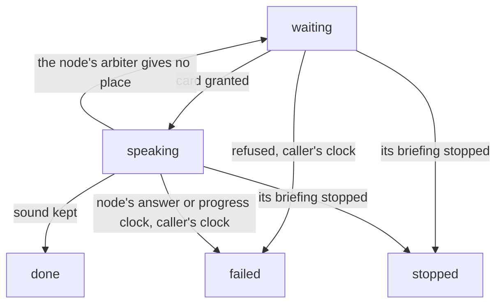

# The store

Everything the engine keeps stands in its own database and in its own folder under the data root, `voice/`,
and nowhere else. No other unit reads them; they reach what is in them through the API
(`docs/boundary-api.md`).

## The database

- **A PostgreSQL database of the engine's own,** at the address the settings' `database` names, read and
  written through sea-orm. The service runs the migrations as it starts.
- **The node and training scripts** read and write the same tables, at the same address, through the
  settings file the service reads.

### `voices`

One row per trained voice.

| Column | What it holds |
|---|---|
| `name` | the voice's name, the key |
| `language` | the language its lines are spoken in, as the language data names it |
| `checkpoint` | its folder, as a name under the voices folder; its `voice.toml` says its engine (`docs/voice-plan.md`, 「The voices」) |
| `reference` | a retired VoxCPM2 voice's reference clip, as a name under the voices folder (`reference/<key>.wav`); empty for a voice that speaks with none, as every served voice does |
| `cfg` | a retired VoxCPM2 voice's guidance; not read for a served voice |
| `steps` | a retired VoxCPM2 voice's diffusion steps per patch; not read for a served voice |
| `current` | 1 for the one current voice, 0 for every other; at most one row is current |
| `set_at` | when the row was last written, in epoch seconds |
| `style` | its delivery instruction, plain words without brackets, empty for none |
| `seed` | the seed every line is spoken on, from 0 up |
| `by_sentence` | 1 where a line is spoken a sentence at a time |
| `prompt_clip`, `prompt_words` | a retired VoxCPM2 voice's Korean continuation prompt: a clip in its own directory and the words it says, both empty for none |
| `prompt_en_clip`, `prompt_en_words` | its English continuation prompt, the same way |

### `voice_names`

One row per spelling whose reading is settled: the agreed readings a line's spoken words are derived with, and
the readings the model chose for spellings no row held (`docs/voice-plan.md`, 「How names are said」).

| Column | What it holds |
|---|---|
| `written` | the spelling, matched whatever its case, the key |
| `ko` | what a Korean stretch says in its place, empty to leave it as written |
| `en` | what an English stretch says in its place, empty to leave it as written |
| `set_at` | when the row was last written |

A table first made is given the seed names of `data/ko/voice-names.toml`; a table that stands is left as it is.

### `voice_nodes`

The voice node list: the nodes whose voice server speaks a line (`docs/voice-plan.md`, 「The voice nodes」).

| Column | What it holds |
|---|---|
| `name` | a node, by its name in the node service's list, the key |
| `position` | its place in the list, the order free nodes are tried in |
| `added_at` | when it was put on the list |

It starts empty. The card arbiter changes it through the voice's adapter; nothing else keeps a list of voice
nodes.

### `voice_briefings`

One row per briefing (`docs/boundary-api.md`, 「Briefings」), the rows kept from before the engine spoke
briefings among them.

| Column | What it holds |
|---|---|
| `run_id` | the briefing's id, the key |
| `chat_id` | the room it was spoken for, as its caller numbers it |
| `message_id` | the line it speaks; null while it awaits one, or where it was let go without one |
| `kind` | `summary` or `full` |
| `title` | a summary's title; null where none was given |
| `synthesis_id` | the synthesis that spoke it; null on a row the engine did not speak |
| `plays` | 1 where a listener plays it by itself, 0 where it does not |
| `awaits_line` | 1 while a summary awaits its line, 0 otherwise |
| `voice_message_id` | the voice message a row from before the engine spoke briefings went out as; null on every other |
| `sent_at` | when it ended done, in epoch milliseconds |
| `seconds` | how long its sound runs, once it is done |
| `sound_path` | its sound's place under the data root, once it is done; a row the engine did not speak keeps the place it was given |
| `started_at` | when it was taken in, in epoch milliseconds |
| `finished_at` | when it ended, done, failed or stopped |

### `voice_syntheses`

One row per text handed to the engine.

| Column | What it holds |
|---|---|
| `id` | the synthesis's id, the key |
| `voice_name` | the voice it is spoken in |
| `text` | the written words |
| `spoken` | the words the voice says, given by the caller or derived; null until they stand |
| `language` | the language the line is said in, `ko` or `en`; null on a row taken in before lines named one, which is said in its voice's |
| `emotion` | the emotion it was asked for; null where none was |
| `key` | the caller's key for the line (`docs/boundary-api.md`, 「Syntheses」); null where none was given. No two rows that have not failed hold one key |
| `state` | `waiting`, `speaking`, `done`, `failed` or `stopped` |
| `failure` | why a `failed` row ended, an English sentence naming the node, the stage and the clock where one of them ended it, or `its reason was not kept` where the engine never held one; null on every other |
| `duration_ms` | the sound's length once it is done; null before |
| `created_at` | when it was taken in, in epoch milliseconds |

A row's `state` moves as the boundary's state machine says (`docs/boundary-api.md`, 「Its states」):

- **Only `waiting` and `speaking` move;** `done`, `failed` and `stopped` are ends, and a write that would move an
  ended row leaves it as it stands.
- **A row moves to `failed` with its `failure` in the one write,** so no failed row stands without its reason.
- **The clocks that end a row are the engine's policy,** not columns: the caller's, the node's answer and the
  node's progress (`docs/boundary-api.md`, 「The clocks」). What a row waits on, and since when, is the running
  process's and is never written; a process that takes a row up names its wait again.

### `voice_transcriptions`

One row per set of sound files handed to the transcriber.

| Column | What it holds |
|---|---|
| `id` | the transcription's id, the key |
| `language` | the language its files are spoken in |
| `state` | `waiting`, `running`, `done` or `failed` |
| `text` | what was heard, one file's words to a line; null until done |
| `created_at` | when it was taken in, in epoch milliseconds |

### `voice_encodings`

One row per recording encoded into a sound.

| Column | What it holds |
|---|---|
| `id` | the encoding's id, the key |
| `state` | `waiting`, `done` or `failed` |
| `from_wav` | the recording's path |
| `sound_path` | where the encoded sound was written; null before |
| `created_at` | when it was taken in, in epoch milliseconds |

### `voice_events`

The events the service publishes, for a reader resuming.

| Column | What it holds |
|---|---|
| `id` | the event number, the key |
| `kind` | the event's kind |
| `at` | when it happened, in epoch milliseconds |
| `data` | the member, as the event's data answers it |

The last 1,000 events are kept; every write past them lets the oldest go.

## The migrations

- **Each migration makes its tables** with their indexes, column for column in the shape the rows already
  read in, so rows copied in keep every column their readers name. Its record stands in
  `voice_migrations`, so the database may be shared with another service's tables. The `citext` extension is
  created where it is missing.
- **A migration may also bring rows to what the tables state:** every `failed` synthesis holding no `failure`
  is given `its reason was not kept`.
- **A table's `rowid`** is the identity the rows already kept carry; nothing reads it.

## The folder

Under the data root's `voice/`:

| Place | What it holds |
|---|---|
| `voices/` | the installed voices, a folder per checkpoint, and `reference/` (`weights/checkpoints.toml`) |
| `syntheses/` | a synthesis's sound, one `<id>.ogg` each, OGG/Opus |
| `encodings/` | an encoding's sound, one `<id>.ogg` each, OGG/Opus |
| `locks/` | `voice-node-<node>.lock`, one per voice node, taken by a node script that speaks through it |
| `demands/` | the ledger of the demands of the arbiter's master the service holds, one empty file each, named by the demand's id: written as it is asked, removed once the master answers its give-back or answers `404` for its id, and every one left given back as the service starts, with every demand of a `voice:synthesis:` work key the master holds |
| `voice.token` | the bearer token every voice server checks, `0600` |
| `studio/` | the script studio's data root where the settings name no other (`docs/script-studio.md`) |
| `voice-lines/` | the training lines' files (`docs/voice-lines.md`) |

Nothing here is committed and no test writes it.
