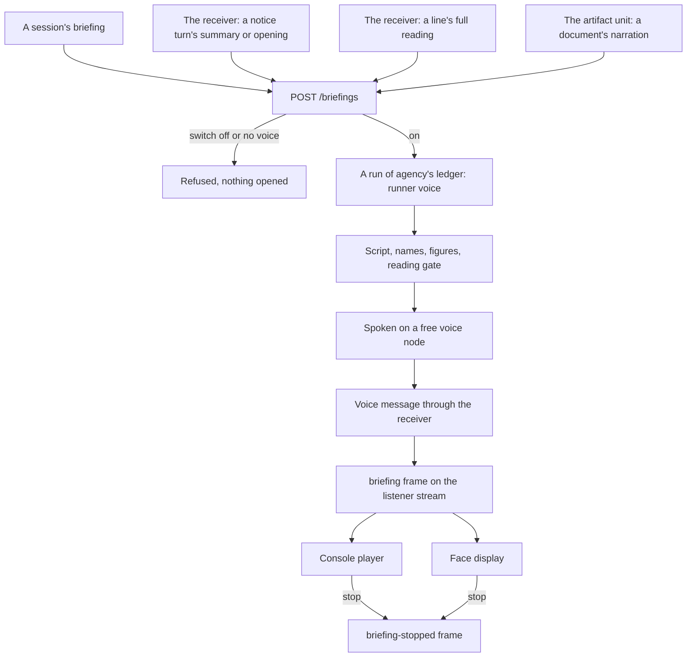

# Briefings

How a briefing is launched and run, whose voice speaks it, the two voices of a line, a document's narration, where
each voice is written down, and the listeners that play a briefing the moment it is sent. How a line becomes sound
is `docs/voice-plan.md`. The voice briefing's two switches, the notice turns whose summary is launched, and the
chip a console line carries are the receiver's (its `docs/voiced-notices.md`); this document starts where a
briefing is handed to the voice.

## The briefing

- **A briefing is a line said out loud in a room in an agent's own trained voice,** launched through
  `POST /briefings` or `voice brief`.
- **Speaking is slow,** so it runs apart: the launch checks the switch and the voice, writes the words to a file
  only it can read under the voice's folder, opens a run in agency's ledger, has agency start `runner voice` in the
  agent's host, and answers at once.
- **The runner** makes the line a script, reads it through the names, the figures and the reading gate, has it
  spoken in the voice the agent's registration names on a free voice node (or this machine's card where the list
  is empty), encodes it with nothing laid over the voice, puts the voice message in the room through the receiver,
  files the `briefing` frame, and closes its run with how it ended.
- **There is no other synthesiser:** an agent with no voice is refused at launch, and a voice that is not installed
  or a voice server that cannot be reached is a failed briefing, told to the room.
- **A launch names who started it** (`started_by`) and has something to say; one without is refused.
- **`voice say`** does the same work while holding its caller: the hand tool for a shell, never the way a session
  speaks.

### The spoken text travels with the sound

- **The exact reading handed to the synthesiser is the voice message's caption,** folded past the caption's limit
  into replies to that voice (`docs/voice-plan.md`, 「The caption」). Where a road refuses the caption's formatting,
  the sound goes without it and the reading follows in folded replies; a continuation that fails says the sound
  arrived but its text did not all arrive, and the sound is never resent.
- **The room's record keeps the line as written,** as the receiver files it.

### One card, one briefing at a time

- **A synthesiser on this machine stands in one line,** the lock in the `voice/mouth` entry; each voice node's server
  keeps a line of its own and takes none here. The reading gate runs before the line, wanting nothing of the card.
- **A run stands in the line five minutes before it gives up its turn,** and the room then hears that it did not get
  a turn rather than that the synthesiser failed.
- **A run's cap and its stop reach the synthesiser,** so a run called off leaves nothing on the card.

### A briefing that cannot be spoken says so

- **One notice in the room the voice was for,** through the receiver's `POST /rooms/{chat}/notices`, so the room's
  voice says in its own words that the briefing is not coming and roughly why: a synthesiser that would not start or
  answer, a voice server out of reach, a turn that never came, a sound that could not be read or put in the room, the
  run stopped from outside. The run closes as `failed`.
- **It is said once.** The reading gate's failure is one of these notices; it speaks nothing, since speaking the raw
  words is the fault the gate removes. A run that has already spoken does not speak again on its way out, and
  nothing repeats on its own.

## Whose voice

- **A voice is an agent's.** Each agent's registration names the voice its words are spoken in, or none, read from
  agency's agent list; a briefing is made in the voice of the agent whose line it is (`agent`, else the settings'
  `agent`).
- **An agent with no voice is never spoken.** The launch refuses with `voiceless` before it opens a run, and the
  runner asks again before anything is spoken and closes its run as refused.
- **The chat agent's voice is the one marked current** where its registration names none; `scripts/voice-install.ts
  --use <name>` moves the current mark.
- **A voice that cannot speak fails the briefing:** a voice the table does not hold, weights missing from the
  machine that would speak them, a voice server that does not answer.

## The switch

- **The voice briefing's switch and its autoplay switch are the receiver's,** read from `GET /voice-briefing`.
- **They are read at the voice's door, every time:** the launch reads the switch before it opens a run; the runner
  reads it again before anything is synthesised, and a briefing waiting in a line when it goes off closes as refused
  and says nothing; `voice say` reads it the same way. What never reaches a room is outside it: measuring a voice, a
  node's own speak command, and the training scripts.
- **A refusal is `switched_off`,** and a session that meets it says in text what it meant to say out loud.
- **Autoplay is stamped on the `briefing` frame** as the voice files it, so every listener follows one answer.

## Two voices of a line

- **The summary** is what is heard live: a sentence or two of a notice turn's gist with a one-line title, made the
  moment the turn ends, sent on the room's road, and what plays by itself.
- **The full reading** is the whole line read out, made only when its chip is pressed, kept on that line, sent to no
  road and to no listener.
- **The summary comes first:** a full reading or a narration waits while any summary is being made or waiting to be
  made, and only then asks for a node or this machine's card.

### A summary

- **It awaits its line until its round ends.** A summary launched with `awaits_line` is written down as awaiting the
  line, and the receiver names the line once its round has sent it (`POST /briefings/{run}/line`); a summary whose
  round ends without a line is let go by the receiver the same way and stands as the voice message it is.
- **A newer summary replaces one still waiting:** a summary of a room that has not gone out when a newer one of the
  same room is launched closes as `superseded` without a word, asked wherever it waits: before it is read, while it
  waits for a node or the card, and once spoken while it waits behind an earlier one. One already on its way out is
  not recalled.
- **One summary at a time in a room:** a summary does not go out while an earlier one of the same room is still being
  made, nor before the earlier one has had the time its sound runs and a short pause after it.
- **What is spoken is the summary as written,** made a script and read through the reading gate; it never passes the
  polishing gate.
- **A summary that never got its turn tells nobody:** its line stands in the room as text already, so the run closes
  as failed with the wait in its log. Every other failure of a summary is told once, as every failed briefing is.

### A full reading

- **Launched with `kind` `reading`** and the line it voices, for an agent with a voice; nothing is made before it is
  asked for.
- **It is polished for listening** (`docs/voice-plan.md`, 「A full reading is polished for listening」); switched
  off, failed or out of time, the mechanical script is read as it stands.
- **It is kept on the line:** the sound under the voice's folder and its row's `sound_path`, served at
  `GET /briefings/{run}/sound`, so a later press plays it at once. It carries no frame.
- **A reading that fails says so on the chip** alone: no notice goes to the room.

## A document's narration

- **A narration is a script for the ear kept as a document's sound,** launched with a `document`: by the artifact
  unit once a deep dive's result or a filed document is written, or by `voice brief --document <id>` for a document
  already filed, the script on standard input.
- **It goes to no road and carries no frame.** It is the document's sound, heard from the document.
- **It is spoken as written:** the names, the figures and the reading gate stand in front of it; the polishing gate
  does not.
- **It is kept under the voice's folder** and served at `GET /briefings/{run}/sound`, named by the document's title,
  read from the artifact unit.
- **A narration that cannot be spoken tells nobody:** the document stands whole without the sound. Only a launch
  refused outright is answered, to whoever launched it.
- **It asks the switch and the voice like every briefing,** waits behind the summaries, and is held to the same cap.

## Where each voice is written down

- **`voice_briefings`** (`docs/store.md`): one row per briefing that belongs to a line: the room, the line, whether a
  summary still awaits it, the kind, a summary's title, the voice message it went out as, the kept sound, and when
  it was launched. The runner writes the voice message the moment it is saved, before any screen is told the message
  landed, so no screen reads the voice before it can tell which line it belongs to.
- **The receiver reads them** at `GET /briefings` to stand a summary on its line.

## What a listener hears

- **The listener stream,** `GET /briefings/events` (`docs/boundary-api.md`, 「The listener stream」): `briefing`
  frames, `briefing-stopped` frames, the chat agent's `presence`, and a keep frame every five seconds, resumable by
  the last id read.
- **A `briefing` frame** carries the chat and the voice message, by which a listener fetches the sound; the words
  spoken; a summary's title; the length and when it was sent; the emotion; the face the face unit's entry answers for
  it, or none where the entry does not answer; and whether it plays by itself.
- **The emotion is one of a closed set,** `policy/voice.toml`'s `emotions`, one for each face a listener draws. A
  launch naming another word is refused. One naming none carries none, read as the first of the set. It never
  reaches the synthesiser: the voice speaks every line in its own delivery.
- **A stop.** A listener's stop posts `POST /briefings/stop`, and every listener playing that briefing stops,
  wherever the stop was pressed.
- **A late briefing is not played.** A listener that learns of a briefing more than two minutes after it was sent
  shows it at most.
- **The presence** is one state for the chat agent as a whole: `writing` while any turn writes, `thinking` while a
  turn runs and none writes, `idle` otherwise. It carries nothing of any room.

## The console's player

- **The plugin bundle at `/briefing`** (`client/`) stands a small player of its own for a briefing that plays by
  itself, apart from the console's other news, and goes when the sound ends or is stopped.
- **Where it stands:** at first at the top-left of the page's own panel, under its title row; it is drawn inside the
  console's layout, so a dialog or drawer covers it like the rest.
- **It is moved as a picture-in-picture window is:** dragged with a mouse or a finger within the page's panel; let
  go, it settles on the nearer side at the height it was let go at, a quick throw settling it on that side; a press
  that moves less than a few pixels is a press. Where it was left is remembered in the browser and shown as low as a
  shorter panel allows.
- **It comes and goes from its own middle,** growing out of its centre a little past its size and back, shrinking
  back into it, with no fade; a reader who asked for less movement sees it appear and go at once.
- **While it plays it swells with the sound,** by a tenth of its size at most, only the pill behind its presses; the
  visualiser and the close mark keep their size and place, and nothing else on the page moves.
- **It shows two things and no words:** an audio visualiser, the sound's own where the browser lets it be read and
  moving on its own where not, and a close mark. Paused or blocked, a play mark stands in the visualiser's place. It
  names itself to assistive technology, and each press names itself in a tooltip, in the console's language pack.
- **Its presses:** the visualiser goes to the voice message in its room and leaves it playing, or plays it where
  paused or blocked; the close mark stops it.
- **It can be tried from its settings section** with a trial voice shipped with the bundle, nothing synthesised:
  played through the same player, heard by this tab alone, waiting behind a briefing playing. The side and height it
  stands at are shown and changed there, and a reset puts it back.
- **One after another:** a briefing arriving while another plays waits and plays after a short pause; a stop ends the
  one playing and every one waiting in this browser, and a stop from another listener ends only the one it names.
- **One tab plays:** the console's tabs in one browser agree which one plays, the tab looked at first, then one
  shown, then a hidden one; a briefing already played or stopped is not played again.
- **Starting a briefing pauses any voice message playing** on a room screen.

## A face display

- **A face display is a listener like the console's player:** it reads the listener stream and plays the sound. It
  is the face unit's, which documents it. It reads what the player ignores: the face a briefing shows, its emotion
  and the presence.
