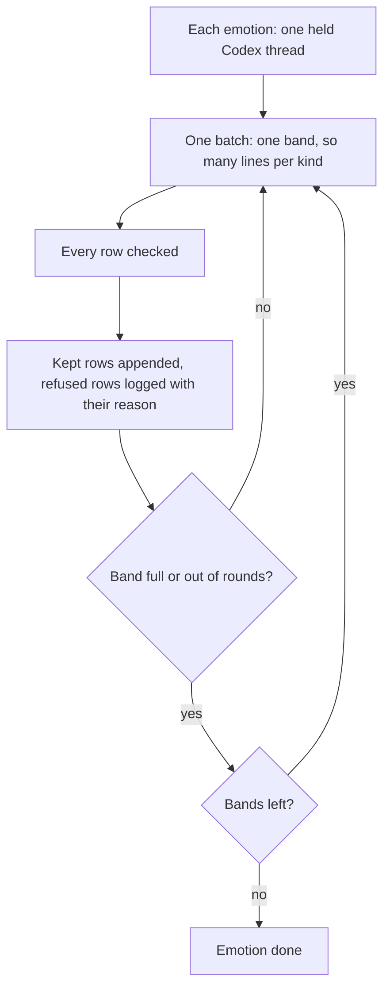

# Training lines

## What it is

- **A sentence list for training a voice:** lines in the agent's manner of speech, each with its emotion and its
  reading, the line as a synthesiser is handed it.
- **Written by Codex, run directly by the generator** `scripts/voice-lines.ts`. The generator starts the Codex CLI
  itself; no provider order or switch of another unit is read or changed.
- **Recording and synthesis are not part of it.** The list is the text side of a training set; the sound is made by
  whoever trains the voice (`docs/voice-plan.md`, 「Where the voice is trained」).

## The speech standard

- **The one statement of it is the generator's instructions,** `prompts/voice-lines.md`, in English, which Codex
  reads at the head of every thread, filled in with two things:
  - **the agent's persona,** the file the run is handed: who the agent is, how it talks and names itself, the people
    it may name, and its own invented example lines. It names the agent and the people around it, so it is the
    deployment's own and stands in no repository (`docs/deploy.md`);
  - **the language material** it cannot do without, loaded from `data/ko/voice-lines.toml`: the kinds' and bands'
    names, what each emotion sounds like, how a Korean speaker reads figures, roman words, commands and symbols, the
    words of meta talk, and the words a line never uses.
- **Nothing real goes to Codex** beyond the persona. The instructions carry invented examples only: no line out of
  any record and no room's words.
- **The reading follows the voice:** names by the voice name table (`docs/voice-plan.md`, 「How names are said」),
  listed under the instructions, figures by its figure rules, roman words by their sound, symbols as they are said.
  Unlike a live briefing, a web address is spelt out in the reading, since the list is there to teach the voice hard
  notation.

## The spread

- **Emotion:** every emotion a briefing may be spoken with, `policy/voice.toml`'s `emotions`.
- **Length band,** by the reading's length in Hangul syllables: a word or two (1 to 8), a short sentence (9 to 30),
  an ordinary sentence (31 to 80), a long briefing (81 to 180). The bands' names are the data file's.
- **Kind:** a statement, a question, an exclamation, and a mixed line holding figures, English words, commands,
  brackets, symbols or a web address, whose reading therefore differs from its text.
- **A cell is one emotion, one band and one kind,** and every cell has the same target, twenty lines unless the run
  is told otherwise.
- **A row is filed under the band its reading measures,** whatever band was asked for, while that cell has room.

## How a run goes

- **One held thread per emotion:** the instructions and the emotion's description open it, and every later batch
  resumes it, read out of the cache rather than sent again.
- **A batch asks for one band:** for each kind still short, what it lacks and a third more, at least five and at most
  twelve, listing what the emotion and band already hold so a thread opened afresh does not write them again.
- **A band gets five rounds,** counted across restarts; a band still short after them stays short.
- **The answer is held to a closed JSON schema** Codex enforces: a list of rows, each a kind, a text and a reading.
- **Codex runs on the model and effort the run is handed,** named on every call, resumed ones included; the batch on
  standard input, closed behind it; approvals and the sandbox bypassed; started in an empty directory so no
  instructions file is read into it.
- **Emotions run two at a time** unless told otherwise. **A failed batch is tried twice more,** a minute apart, the
  second on a fresh thread; still failing, its emotion stops, the others finish, and the run ends failed so its unit
  starts it again.

## What a row must be to be kept

- **The text:** one line, no tab, no markdown mark, no dash standing between words.
- **The reading:** Hangul syllables, spaces and `. , ? !` only, so every figure, roman letter and symbol is said.
- **The kind holds:** a question ends on `?`, an exclamation on `!`, a statement on neither, and a mixed line's
  reading differs from its text.
- **No word the data file bans,** each read as the wording check reads a glossary entry, bmo-markup's `wording`:
  a term standing alone, and not in a phrase where it keeps its own sense. A banned term a name's reading in the
  voice name table spells is no use of the word in the reading. **No meta talk,** the data file's list.
- **Not a duplicate:** readings reduced to their Hangul are compared with every row kept; the same reading is a
  duplicate, and one of six syllables or more whose syllable pairs overlap another's by 70 percent or more is a near
  duplicate.
- **Its cell has room** and its length fits a band.

## The files

- **Under the data root's `voice/voice-lines/`,** or the folder `--out` names.
- **`lines.tsv`:** a header and one row per line with `id`, `emotion`, `text` and `reading`, tab-separated.
- **`lines.jsonl`:** the same rows with their band and kind, one JSON object per line; a restart reads it back.
- **`rejected.jsonl`:** every refused row with its reason.
- **`progress.json`:** the run's state, batches asked, rows written, kept and refused by reason, tokens spent, each
  emotion's thread and each band's rounds.
- **Ids** run upward from one in the order rows were kept, under the prefix the run is handed, and never change.

## Running it

- **A run takes hours and is carried by a unit of its own,** restarted on failure: `systemd-run --user --unit
  bmo-voice-lines --same-dir -E PATH="$PATH" -p Restart=on-failure -p RestartSec=900 bun scripts/voice-lines.ts run
  --persona <file> --model <model> --effort <effort>`. It always resumes from its files.
- **`bun scripts/voice-lines.ts status`** prints the progress.
- **`run` takes** `--persona <file>`, `--model <model>` and `--effort <effort>`, which it needs, and `--out <folder>`,
  `--prefix <id prefix>` (`ko`), `--per-cell <n>` (20), `--at-once <n>` (2), `--rounds <n>` (5) and
  `--emotion <emotion>` for one emotion alone.
